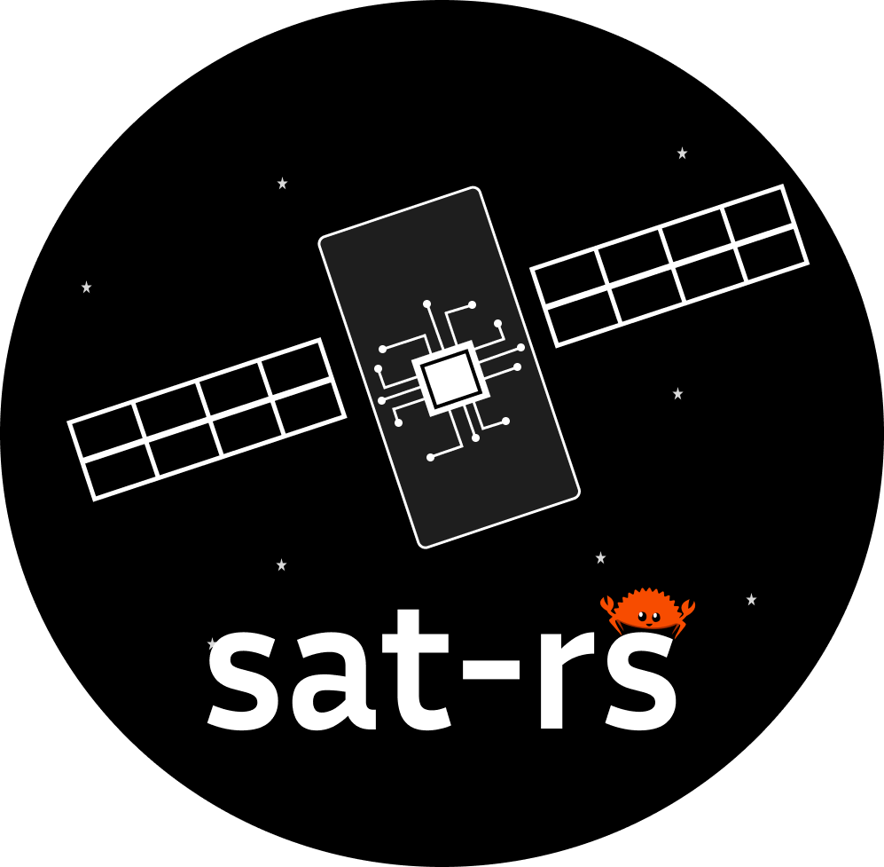

<p align="center">  </p>

[](https://documentation.irs.uni-stuttgart.de/projects/sat-rs/book/)
[](https://crates.io/crates/satrs)
[](https://docs.rs/satrs)
[](https://matrix.to/#/#sat-rs:matrix.org)

sat-rs
=========

This is the repository of the sat-rs library. Its primary goal is to provide re-usable components
to write on-board software for remote systems like rovers or satellites. It is specifically written
for the special requirements for these systems. You can find an overview of the project and the
link to the [more high-level sat-rs book](https://documentation.irs.uni-stuttgart.de/projects/sat-rs/book/)
at the [IRS software projects website](https://documentation.irs.uni-stuttgart.de/projects/sat-rs/).

This is early-stage software. Important features are missing. New releases
with breaking changes are released regularly, with all changes documented inside respective
changelog files. You should only use this library if your are willing to work in this
environment.

A lot of the architecture and general design considerations are based on the
[FSFW](https://egit.irs.uni-stuttgart.de/fsfw/fsfw) C++ framework which has flight heritage
through the 2 missions [FLP](https://www.irs.uni-stuttgart.de/en/research/satellitetechnology-and-instruments/smallsatelliteprogram/flying-laptop/)
and [EIVE](https://www.irs.uni-stuttgart.de/en/research/satellitetechnology-and-instruments/smallsatelliteprogram/EIVE/).

# Overview

This project currently contains the following crates:

* [`satrs-book`](https://github.com/ustgt-irs/sat-rs/tree/main/satrs-book):
   Primary information resource in addition to the API documentation, hosted
   [here](https://documentation.irs.uni-stuttgart.de/projects/sat-rs/book/). It can be useful to read
   this first before delving into the example application and the API documentation.
* [`satrs`](https://github.com/ustgt-irs/sat-rs/tree/main/satrs):
   Primary crate.
* [`satrs-mib`](https://github.com/ustgt-irs/sat-rs/tree/main/satrs-mib):
   Components to build a mission information base from the on-board software directly.

## Examples

All examples and their helper crates are located inside the
[`examples`](https://github.com/ustgt-irs/sat-rs/tree/main/examples) folder:

* [`example-std`](https://github.com/ustgt-irs/sat-rs/tree/main/examples/example-std):
   Example on-board software using various sat-rs components which can be run on a host computer
   or on any system with a standard runtime like a Raspberry Pi.
* [`minisim`](https://github.com/ustgt-irs/sat-rs/tree/main/examples/minisim):
   Mini-Simulator based on [nexosim](https://github.com/asynchronics/nexosim) which
   simulates some physical devices for the `example-std` application device handlers.
* [`client`](https://github.com/ustgt-irs/sat-rs/tree/main/examples/client): Ground client to command the `example-std` application and the STM32H7 examples.
* [`types`](https://github.com/ustgt-irs/sat-rs/tree/main/examples/types): Telecommand and telemetry definitions shared by the
   `example-std` application, the STM32H7 examples and the `client`.
* [`embedded`](https://github.com/ustgt-irs/sat-rs/tree/main/examples/embedded):
   Simple examples using sat-rs components on a bare-metal system with constrained resources,
   running on the NUCLEO-H753ZI board. `stm32h7-nucleo-rtic` uses the
   [RTIC](https://github.com/rtic-rs/rtic) framework and `stm32h7-nucleo-embassy` uses the
   [embassy](https://embassy.dev/) executor.

The library crates and the `example-std` application have their own `CHANGELOG.md`.

# Related projects

 In addition to the crates in this repository, the sat-rs project also maintains other libraries.

 * [`spacepackets`](https://github.com/ustgt-irs/spacepackets-rs): Basic ECSS and CCSDS
   packet protocol implementations. This repository is re-exported in the
   [`satrs`](https://github.com/ustgt-irs/sat-rs/tree/main/satrs)
   crate.
 * [`cfdp`](https://github.com/ustgt-irs/cfdp-rs): CCSDS File Delivery Protocol
   (CFDP) high-level library components.

# Flight Heritage

There is an active and continuous effort to get early flight heritage for the sat-rs library.
Currently this library has the following flight heritage:

- Submission as an [OPS-SAT experiment](https://www.esa.int/Enabling_Support/Operations/OPS-SAT)
  which has also
  [flown on the satellite](https://blogs.esa.int/rocketscience/2024/05/21/ops-sat-reentry-tomorrow-final-experiments-continue/).
  The application is strongly based on the sat-rs example application. You can find the repository
  of the experiment [here](https://egit.irs.uni-stuttgart.de/rust/ops-sat-rs).
- Development and use of a sat-rs-based [demonstration on-board software](https://egit.irs.uni-stuttgart.de/rust/eurosim-obsw)
  alongside a Flight System Simulator in the context of a
  [Bachelors Thesis](https://www.researchgate.net/publication/380785984_Design_and_Development_of_a_Hardware-in-the-Loop_EuroSim_Demonstrator)
  at [Airbus Netherlands](https://www.airbusdefenceandspacenetherlands.nl/).

# Coverage

Coverage is generated with [`cargo-llvm-cov`](https://github.com/taiki-e/cargo-llvm-cov):

```sh
cargo install cargo-llvm-cov --locked
just coverage --open
```

This tests the `satrs` crate and opens the HTML report in your webbrowser.
